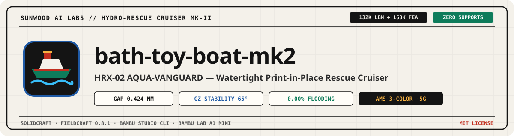
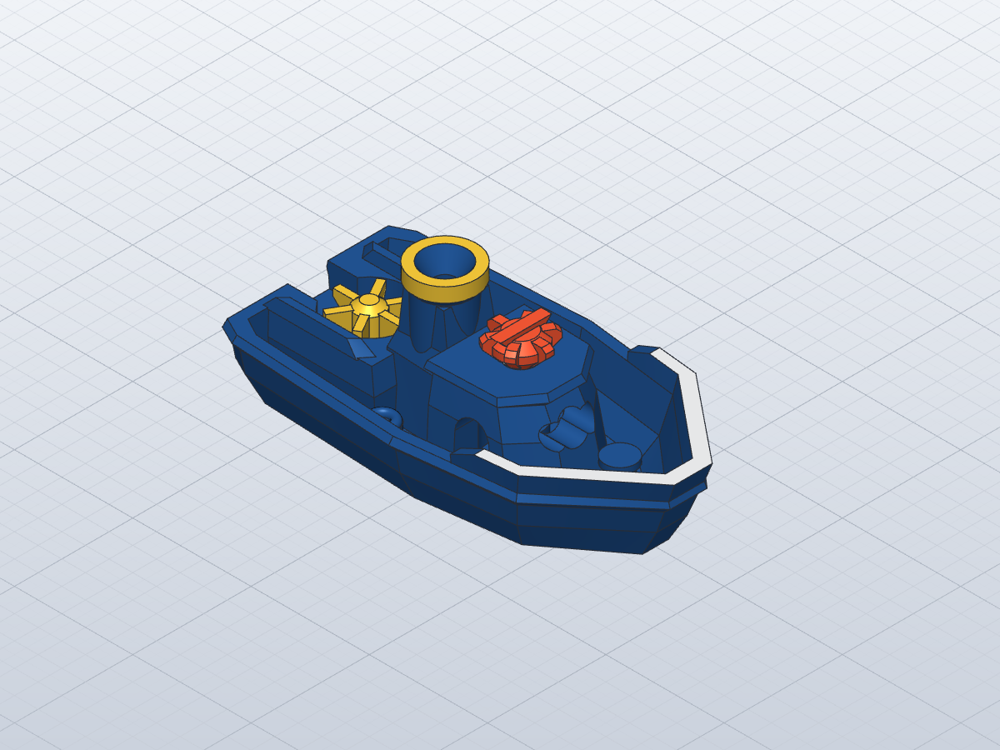
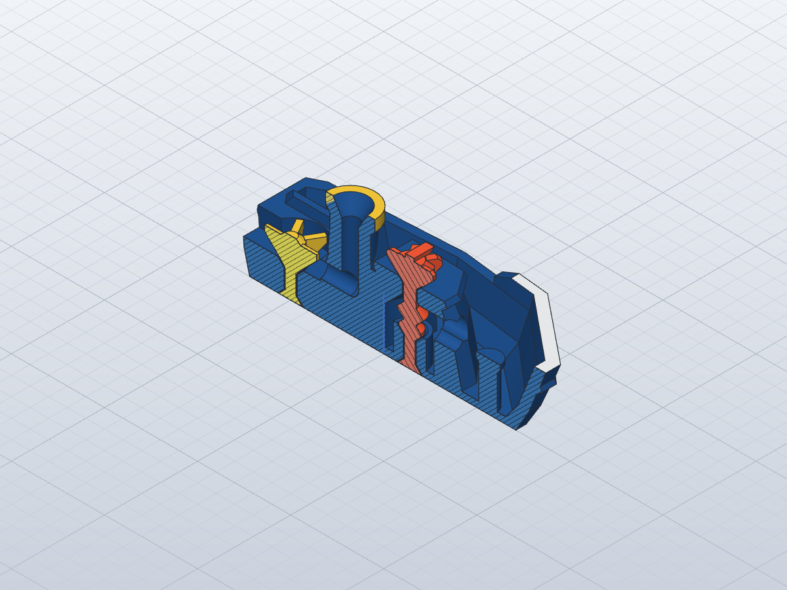
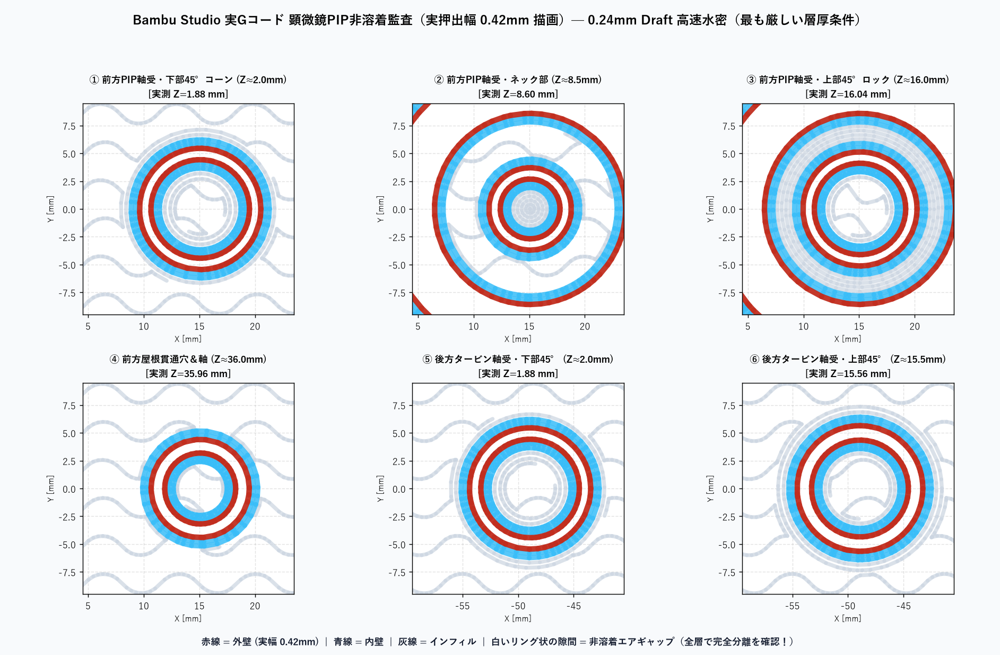

  

  <h1>bath-toy-boat-mk2（おふろレスキュー艇 Mk-II）</h1>
  
<strong>完全水密・サポート材ゼロの Print-in-Place レスキュー艇 — SolidCraft CAD × FieldCraft 3D流体/FEA × Bambu Studio CLI</strong>

  

    
    
    
    
    
  

  

    <strong>🌐 言語:</strong>
    <a href="./README.md">English</a> |
    <a href="./README.ja.md"><strong>日本語</strong></a>
    &nbsp;&nbsp;·&nbsp;&nbsp;
    <strong>📚 ドキュメント:</strong>
    <a href="https://sunwood-ai-labs.github.io/bath-toy-boat-mk2/ja/">ドキュメントサイト</a>
  

---

## ✨ 概要

**`bath-toy-boat-mk2`**（*HRX-02 AQUA-VANGUARD*）は、前作「おふろタグボート v4」の完全水密・サポートレス Print-in-Place 機構を継承しつつ、外観と2つの回転ギミックを全面刷新した進化型モデルです。

**SolidCraft**（コード駆動 3D CAD）・**FieldCraft 0.8.1**（13万セル自由表面 LBM 流体解析＋16万要素 FEA）・**Bambu Studio CLI** で設計・検証し、**6本スポークレーダー舵輪＋6枚羽根ハイドロタービン**をサポート材ゼロで一体造形します。

  
  

---

## 📦 3D プリント用モデルファイル

| ファイル | 内容 |
| :--- | :--- |
| [`cad/out/bath_boat_mk2_ams3color_B.3mf`](./cad/out/bath_boat_mk2_ams3color_B.3mf) | パターン B（深緑ハル＋赤ライン＋白ブリッジ、Z層切替 AMS 3色・交換5回・廃材約5g） |
| [`cad/out/bath_boat_mk2_ams3color_A.3mf`](./cad/out/bath_boat_mk2_ams3color_A.3mf) | パターン A（レスキューレッド主体、交換4回・廃材約4g） |
| [`cad/slicer/hrx02_mk2_patternB_a1mini.gcode.3mf`](./cad/slicer/hrx02_mk2_patternB_a1mini.gcode.3mf) | Bambu Lab A1 mini 用スライス済み（パターン B・サポートなし） |
| [`cad/out/bath_boat_mk2.step`](./cad/out/bath_boat_mk2.step) | 編集用 STEP モデル |

---

## 🔍 造船工学・CAE 検証ハイライト

- **B-rep PIP 精度**: 3閉ボディ（`Hull` / `Radar_Spinner` / `Hydro_Turbine`）、干渉 `0` 件、最小隙間 `0.424264 mm`、non-manifold 欠陥 `0` 件。
- **3D 静水力学 & GZ 復原力曲線**: 浸水限界喫水 `Z = 18.5 mm`（前作比 `+1.0 mm`）、横メタセンタ高さ `GM_T = +30.12 mm`、**横傾き `65°` まで転覆せず起き上がる**復原力を確認。
- **自由表面 LBM 3D 流体解析（`132,704` セル）**: 水密スタンドパイプ＆高床ベイによる **船内バスタブ浸水率 `0.00%`（完全乾燥）** を直接計算で実証。
- **静構造解析 FEA（`163,569` 要素）**: キャビン屋根 20 N 押下で最大変位 `0.00126 mm`・最大 von Mises 応力 `0.2075 MPa`。
- **実Gコード顕微鏡 PIP 非溶着監査（`cad/slicer/mk2_pip_gcode_audit.png`）**: 実押出幅 `0.42 mm` で6箇所の軸受エアギャップを顕微鏡レベルで完全分離確認。

  

---

## 📄 ライセンス

MIT License — 詳細は [LICENSE](./LICENSE) を参照してください。
