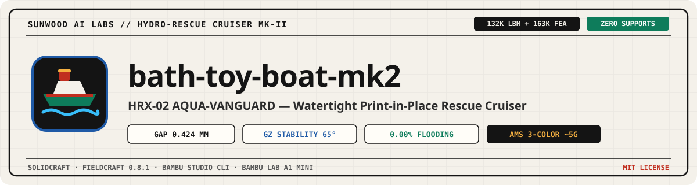
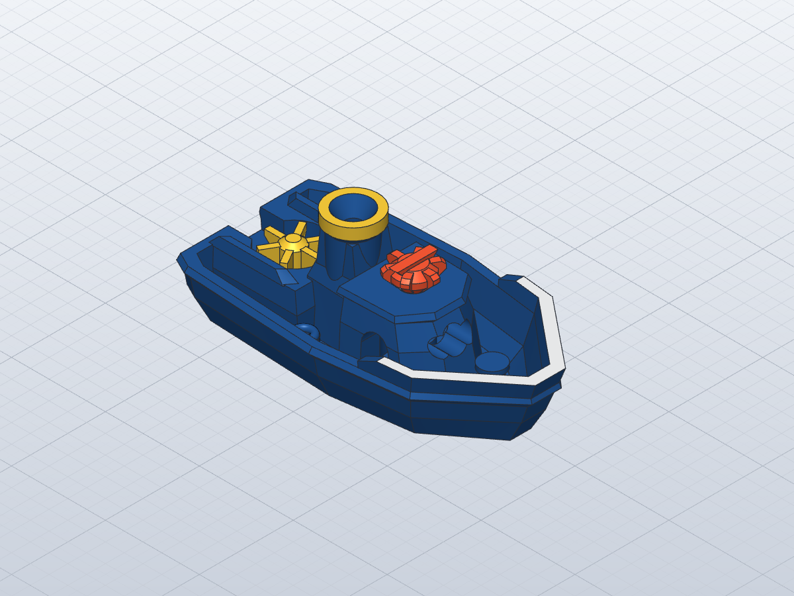
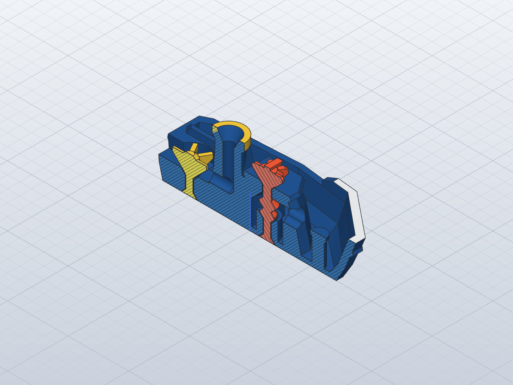
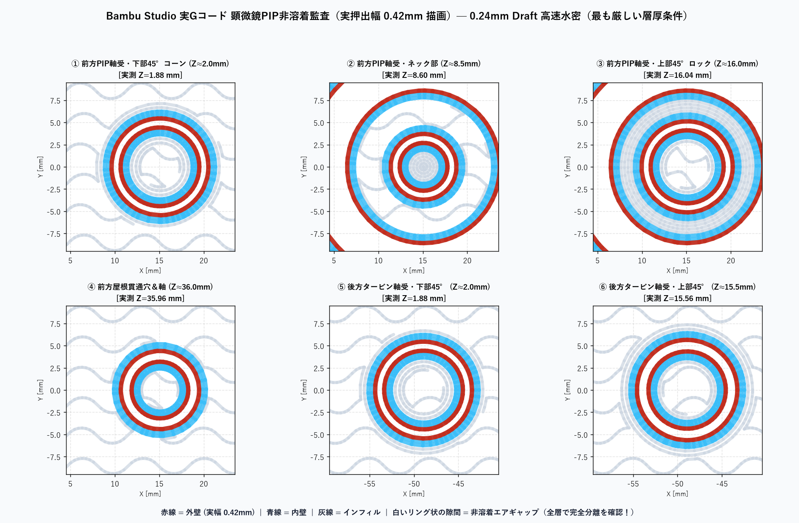

  

  <h1>bath-toy-boat-mk2 (HRX-02 AQUA-VANGUARD)</h1>
  
<strong>Watertight, Zero-Support Print-in-Place Rescue Cruiser — SolidCraft CAD × FieldCraft 3D Fluid / FEA × Bambu Studio CLI</strong>

  

    
    
    
    
    
  

  

    <strong>🌐 Language:</strong>
    <a href="./README.md"><strong>English</strong></a> |
    <a href="./README.ja.md">日本語</a>
    &nbsp;&nbsp;·&nbsp;&nbsp;
    <strong>📚 Docs:</strong>
    <a href="https://sunwood-ai-labs.github.io/bath-toy-boat-mk2/">Documentation Site</a>
  

---

## ✨ Overview

**`bath-toy-boat-mk2`** (*HRX-02 AQUA-VANGUARD*) is the next-generation evolution of our Print-in-Place bath toy tugboat. Built with **SolidCraft** (code-driven 3D CAD), **FieldCraft 0.8.1** (132k-cell free-surface LBM fluid simulation + 163k-element static FEA), and **Bambu Studio CLI**, it prints in one piece with **zero supports**, **two rotating Print-in-Place mechanisms** (6-spoke radar spinner + 6-blade hydro turbine), and **0.00% interior hull flooding**.

  
  

---

## 📦 Ready-to-Print Model Files

| File | Description |
| :--- | :--- |
| [`cad/out/bath_boat_mk2_ams3color_B.3mf`](./cad/out/bath_boat_mk2_ams3color_B.3mf) | Pattern B (Deep Green hull + Red band + White bridge, Z-layer AMS 3-color, 5 swaps / ~5 g waste) |
| [`cad/out/bath_boat_mk2_ams3color_A.3mf`](./cad/out/bath_boat_mk2_ams3color_A.3mf) | Pattern A (Rescue Red hull + White + Deep Green, 4 swaps / ~4 g waste) |
| [`cad/slicer/hrx02_mk2_patternB_a1mini.gcode.3mf`](./cad/slicer/hrx02_mk2_patternB_a1mini.gcode.3mf) | Pre-sliced for Bambu Lab A1 mini (Pattern B, zero supports) |
| [`cad/out/bath_boat_mk2.step`](./cad/out/bath_boat_mk2.step) | Editable STEP CAD model |

---

## 🔍 Naval & CAE Verification Highlights

- **B-rep PIP Precision**: 3 closed bodies (`Hull`, `Radar_Spinner`, `Hydro_Turbine`), `0` interferences, `0.424264 mm` clearance, `0` non-manifold defects.
- **3D Hydrostatics & GZ Righting Curve**: Flooding draft `Z = 18.5 mm` (`+1.0 mm` over v4), transverse metacentric height `GM_T = +30.12 mm`, positive righting arm up to **`65°` heel** without capsizing.
- **Free-Surface LBM Fluid Simulation (`132,704` cells)**: Direct 3D fluid buoyancy confirms `0.00%` interior flooding across the watertight standpipe and elevated turbine bay.
- **Static Structural FEA (`163,569` tet4 elements)**: Under `20 N` cabin roof load, max displacement is `0.00126 mm` and max von Mises stress is `0.2075 MPa`.
- **Microscopic G-code Audit (`cad/slicer/mk2_pip_gcode_audit.png`)**: Audited 6 critical bearing heights at actual `0.42 mm` extrusion width to verify full air-gap separation with zero fusion.

  

---

## 📄 License

MIT License — see [LICENSE](./LICENSE).
